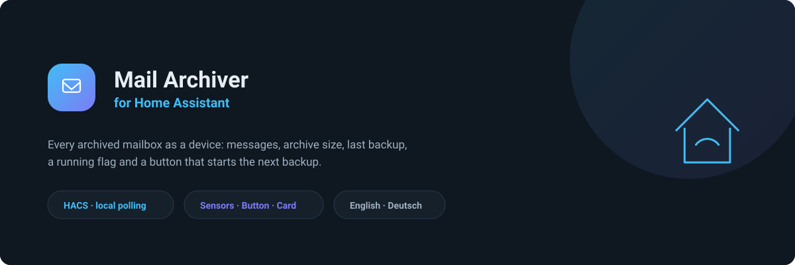
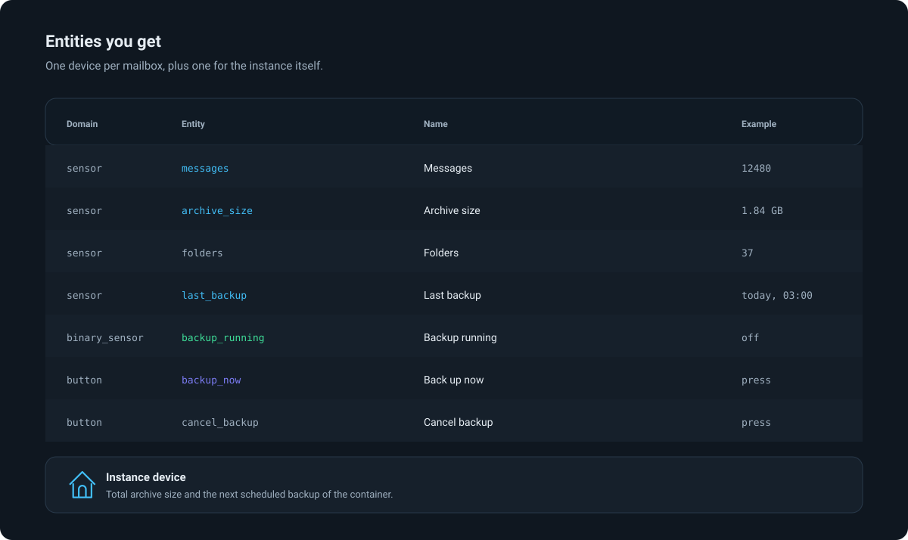
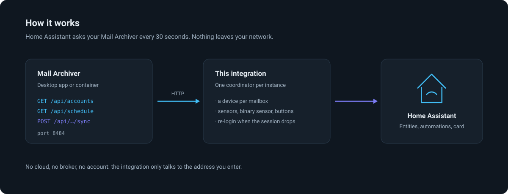
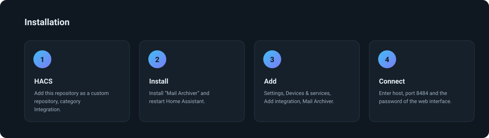
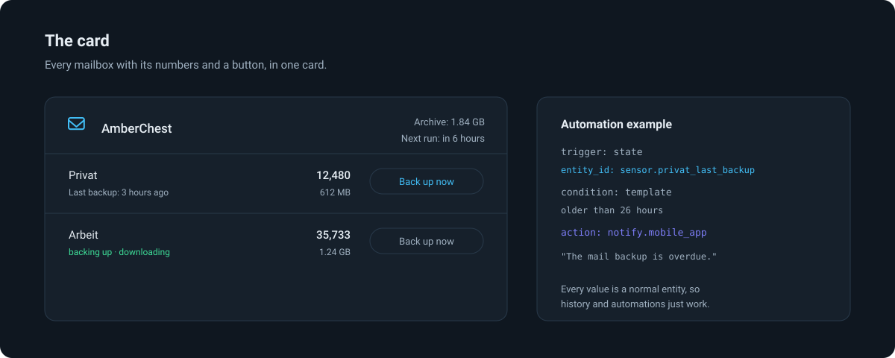

<div align="center">
  

  # AmberChest — E-Mail-Sicherung als Sensoren in Home Assistant

  **Sehen, wann die Postfächer zuletzt gesichert wurden — und aus Home Assistant heraus sichern.**
  Begleitintegration zu [AmberChest — IMAP-Sicherung in einfachen .eml-Dateien](https://github.com/sphings79/amberchest),
  dem selbstgehosteten Werkzeug, das IMAP-Postfächer in schlichte `.eml`-Dateien kopiert.

  [](https://hacs.xyz/)
  [](https://github.com/sphings79/amberchest-home-assistant/releases)
  [](https://www.home-assistant.io/)
  [](LICENSE)

  [English](README.md) · **Deutsch**
</div>

## Inhalt

- [Was die Integration macht](#was-die-integration-macht)
- [Drei Projekte, ein Archiv](#drei-projekte-ein-archiv)
- [Welche Entitäten entstehen](#welche-entitäten-entstehen)
- [Wie es funktioniert](#wie-es-funktioniert)
- [Installation](#installation)
- [Konfiguration](#konfiguration)
- [Die Lovelace-Karte](#die-lovelace-karte)
- [Beispiele für Automatisierungen](#beispiele-für-automatisierungen)
- [MQTT oder diese Integration?](#mqtt-oder-diese-integration)
- [Fehlersuche](#fehlersuche)
- [FAQ](#faq)
- [Credits](#credits)
- [Hinweis](#hinweis)
- [Mitmachen](#mitmachen)
- [Lizenz](#lizenz)

## Was die Integration macht

AmberChest sichert IMAP-Postfächer als Dateien auf die eigene Platte — nur
lesend, inkrementell, ohne auf dem Server etwas zu löschen oder als gelesen zu
markieren. Diese Integration bringt das nach Home Assistant:

- **Ein Gerät je Postfach**, mit der Zahl der gesicherten Nachrichten, der
  Größe auf der Platte, den erfassten Ordnern und dem Zeitpunkt der letzten
  Sicherung.
- **Ein Knopf**, der eine Sicherung startet, und einer, der sie abbricht.
- **Ein Binärsensor**, der an ist, solange gesichert wird — mit Ordner und
  Fortschritt als Attribute.
- **Ein Gerät für die Instanz**, mit der Gesamtgröße des Archivs und dem
  nächsten geplanten Lauf des Containers.
- **Eine Lovelace-Karte**, die alles in eine Karte packt.

Alles läuft lokal über HTTP: keine Cloud, kein Konto, kein Broker.

## Drei Projekte, ein Archiv

| | Was es ist |
| --- | --- |
| [**AmberChest**](https://github.com/sphings79/amberchest) | Die Anwendung selbst: Desktop-App für macOS, Windows und Linux, dazu ein Docker-Container mit derselben Oberfläche. Wird gebraucht — diese Integration spricht mit ihr |
| **AmberChest Integration** (hier) | Dieses Repository: ein Gerät je Postfach, Sensoren, ein Knopf zum Sichern und eine Lovelace-Karte, installiert über HACS |
| [**Home Assistant App (Addon)**](https://github.com/sphings79/amberchest-ha-app) | Betreibt AmberChest unter Home Assistant OS, per Ingress in der Seitenleiste. Der bequeme Weg zu der Instanz, die diese Integration braucht |

## Welche Entitäten entstehen



| Entität | Domain | Beispiel | Bemerkung |
| --- | --- | --- | --- |
| `sensor.<postfach>_nachrichten` | Sensor | `12480` | Gesicherte Nachrichten |
| `sensor.<postfach>_archivgrosse` | Sensor | `612 MB` | `data_size`, Anzeige in MB |
| `sensor.<postfach>_ordner` | Sensor | `37` | Standardmäßig deaktiviert |
| `sensor.<postfach>_letzte_sicherung` | Sensor | `heute, 03:00` | `timestamp`, mit den Zahlen des Laufs als Attribute |
| `binary_sensor.<postfach>_sicherung_lauft` | Binärsensor | `aus` | `running`, mit Ordner und Fortschritt |
| `button.<postfach>_jetzt_sichern` | Knopf | | Startet eine Sicherung |
| `button.<postfach>_sicherung_abbrechen` | Knopf | | Standardmäßig deaktiviert |
| `sensor.amberchest_archivgrosse` | Sensor | `1,84 GB` | Alles zusammen |
| `sensor.amberchest_nachste_geplante_sicherung` | Sensor | `morgen, 03:00` | Nur mit Zeitplan, also nur im Container |

Die Entity-IDs entstehen aus dem Namen, den das Konto in AmberChest hat.
Weil Home Assistant sie aus dem übersetzten Namen bildet, unterscheiden sie
sich von der englischen Fassung.

## Wie es funktioniert



Ein Koordinator je Instanz fragt alle 30 Sekunden `/api/accounts` und
`/api/schedule` ab. Die Sitzungstoken von AmberChest überleben keinen
Neustart des Servers — der Client meldet sich deshalb von selbst neu an, sobald
eine Anfrage mit 401 zurückkommt. Nach einem Neustart deiner Instanz ist also
nichts zu tun.

## Installation



### Über HACS

1. HACS → Drei-Punkte-Menü → **Benutzerdefinierte Repositorys**
2. URL `https://github.com/sphings79/amberchest-home-assistant`, Kategorie **Integration**
3. **AmberChest** installieren, Home Assistant neu starten
4. **Einstellungen → Geräte & Dienste → Integration hinzufügen → AmberChest**

### Von Hand

`custom_components/amberchest` nach `config/custom_components/` kopieren und
Home Assistant neu starten.

## Konfiguration

| Feld | Bedeutung |
| --- | --- |
| Host | Wo AmberChest läuft, zum Beispiel `192.168.1.20` |
| Port | `8484`, falls nicht geändert |
| Passwort der Oberfläche | `AMBERCHEST_UI_PASSWORD` des Containers; leer lassen, wenn keins gesetzt ist |
| HTTPS verwenden | Für eine Instanz hinter einem Reverse Proxy |
| Zertifikat prüfen | Bei einem selbstsignierten Zertifikat abschalten |

Abgefragt wird alle 30 Sekunden. Nach einem Knopfdruck wird sofort neu geladen,
damit der Zustand nicht bis zur nächsten Abfrage wartet.

## Die Lovelace-Karte



Die Karte wird automatisch als Lovelace-Ressource eingetragen. Auf ein
Dashboard legen:

```yaml
type: custom:amberchest-card
title: Mail-Sicherung   # optional
hide_empty: false       # optional, blendet leere Postfächer aus
```

Die Karte findet ihre Postfächer selbst — es muss nichts aufgezählt werden. Auf
einem YAML-Dashboard die Ressource von Hand eintragen:

```yaml
lovelace:
  resources:
    - url: /amberchest/amberchest-card.js
      type: module
```

## Beispiele für Automatisierungen

**Melden, wenn eine Sicherung fehlschlägt:**

```yaml
automation:
  - alias: Mail-Sicherung fehlgeschlagen
    triggers:
      - trigger: state
        entity_id: sensor.privat_letzte_sicherung
        attribute: status
        to: failed
    actions:
      - action: notify.mobile_app
        data:
          message: "Die Mail-Sicherung ist fehlgeschlagen: {{ state_attr('sensor.privat_letzte_sicherung', 'error') }}"
```

**Melden, wenn einen Tag lang nichts gesichert wurde:**

```yaml
template:
  - binary_sensor:
      - name: Mail-Sicherung überfällig
        state: >
          {{ now() - states('sensor.privat_letzte_sicherung') | as_datetime > timedelta(hours=26) }}
```

**Vor dem nächtlichen NAS-Snapshot sichern:**

```yaml
automation:
  - alias: Mail vor dem Snapshot sichern
    triggers:
      - trigger: time
        at: "02:30:00"
    actions:
      - action: button.press
        target:
          entity_id: button.privat_jetzt_sichern
```

## MQTT oder diese Integration?

AmberChest kann dieselben Zahlen auch auf einen MQTT-Broker veröffentlichen.
Beide Wege funktionieren und dürfen nebeneinander laufen.

| | Diese Integration | MQTT |
| --- | --- | --- |
| Broker nötig | nein | ja |
| Einrichtung | Dialog in Home Assistant | Broker in AmberChest eintragen |
| Lovelace-Karte | dabei | nein |
| Aktualisierung | alle 30 s abgefragt | wird während der Sicherung geschickt |
| Ohne Home Assistant nutzbar | nein | ja, mit jedem MQTT-Client |

Wer ohnehin einen Broker betreibt und den Zustand sofort haben will, ist mit
MQTT besser bedient. Sonst ist diese Integration weniger Aufwand.

## Fehlersuche

**„Von dieser Adresse kommt keine Antwort."** Home Assistant muss den Rechner
erreichen, auf dem AmberChest läuft. Im Container ist `localhost` der
Container selbst — hier gehört die IP des Hosts hin.

**„AmberChest ist gesperrt."** Die Konfiguration ist mit einem
Master-Passwort verschlüsselt. Eine Desktop-Instanz bleibt gesperrt, bis es
jemand eingibt; ein Container entsperrt sich über
`AMBERCHEST_MASTER_PASSWORD` selbst.

**Es fehlen Knöpfe.** Standardmäßig ist nur der Knopf zum Sichern aktiv. Den
Abbrechen-Knopf in den Entitätseinstellungen einschalten.

**Die Karte erscheint nicht.** Nach einem Update den Browser-Cache leeren: die
Ressource trägt die Version in der URL, ein Service Worker kann die alte Datei
aber trotzdem festhalten.

## FAQ

### Liest die Integration meine E-Mails?

Nein. Sie liest Zähler und Zeitstempel, dazu den Namen des Postfachs und den
Ordner, an dem eine laufende Sicherung gerade arbeitet. Inhalte verlassen Mail
Archiver nicht.

### Braucht das eine Cloud?

Nein. Home Assistant spricht mit der Adresse, die du einträgst, und mit sonst
nichts.

### Kann ich mehrere Instanzen anbinden?

Ja. Die Integration einfach je Instanz einmal hinzufügen; jede bekommt eigene
Geräte.

### Funktioniert das mit der Desktop-App?

Ja, solange die App läuft und im Netz erreichbar ist. Die Desktop-App hat
keinen Zeitplan, deshalb bleibt der Sensor für die nächste geplante Sicherung
unbekannt.

### Was passiert, wenn ich ein Postfach in AmberChest umbenenne?

Die Entitäten behalten ihre IDs — sie hängen am Konto, nicht am Namen. Der
Gerätename zieht beim nächsten Neustart nach.

### Läuft das mit Home Assistant OS, Container und Core?

Ja, mit allen dreien. Für Home Assistant OS gibt es zusätzlich die
[Home Assistant App (Addon)](https://github.com/sphings79/amberchest-ha-app),
die AmberChest dort selbst betreibt.

## Credits

[AmberChest — IMAP-Sicherung in einfachen .eml-Dateien](https://github.com/sphings79/amberchest)
von [sphings79](https://github.com/sphings79), AGPL-3.0. Diese Integration ist
ein Client für dessen HTTP-Schnittstelle und enthält keinen Code daraus.

Wenn es dir hilft: ein ⭐ auf einem der beiden Repos freut mich, und einen
[Kaffee](https://buymeacoffee.com/sphings) gibt es auch.

## Hinweis

Inoffiziell und aus der Community. Weder mit der Open Home Foundation noch mit
dem Home-Assistant-Projekt verbunden oder von ihnen unterstützt.

## Mitmachen

Issues und Pull Requests sind willkommen. Vor dem Push:

```bash
ruff format . && ruff check . && pytest
cd frontend && npm run build
```

Das gebaute Kartenbündel liegt im Repo, weil HACS keinen Build ausführt.

## Lizenz

MIT — siehe [LICENSE](LICENSE).

<sub>home assistant mail sicherung · imap backup sensor · e-mail archiv home assistant ·
amberchest integration · hacs integration · postfach überwachen ·
sicherungsstatus sensor · lovelace karte e-mail sicherung</sub>
