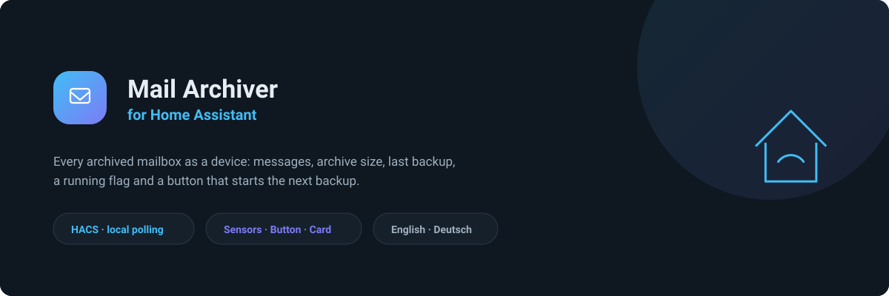
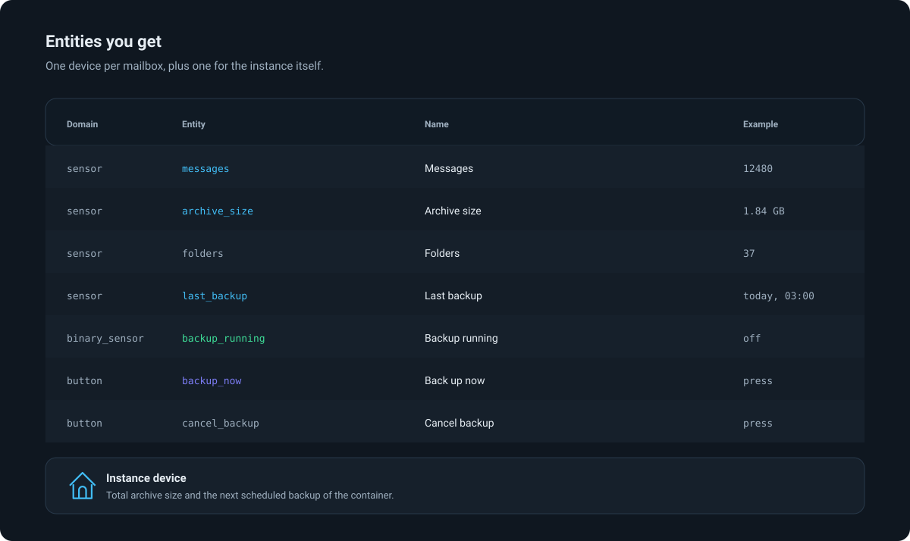
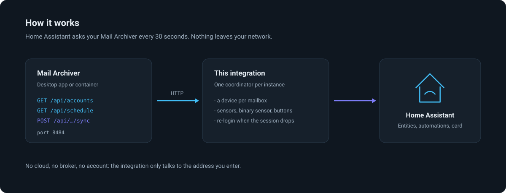
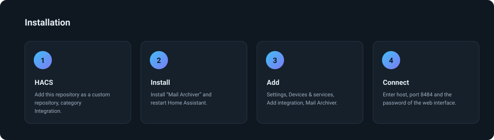
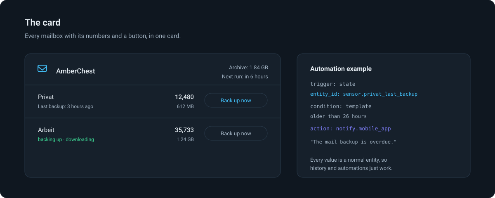

<div align="center">
  

  # AmberChest — Email Backup Sensors for Home Assistant

  **See when your mailboxes were last backed up, and start a backup from Home Assistant.**
  Companion integration for [AmberChest — IMAP mail backup in plain .eml files](https://github.com/sphings79/amberchest),
  the self-hosted tool that copies IMAP mailboxes to plain `.eml` files.

  [](https://hacs.xyz/)
  [](https://github.com/sphings79/amberchest-home-assistant/releases)
  [](https://www.home-assistant.io/)
  [](LICENSE)

  [](https://my.home-assistant.io/redirect/hacs_repository/?owner=sphings79&repository=amberchest-home-assistant&category=integration)

  **English** · [Deutsch](README.de.md)
</div>

## Table of contents

- [What this integration does](#what-this-integration-does)
- [Three projects, one archive](#three-projects-one-archive)
- [Entities you get](#entities-you-get)
- [How it works](#how-it-works)
- [Installation](#installation)
- [Configuration](#configuration)
- [The Lovelace card](#the-lovelace-card)
- [Automation examples](#automation-examples)
- [MQTT or this integration?](#mqtt-or-this-integration)
- [Troubleshooting](#troubleshooting)
- [FAQ](#faq)
- [Credits](#credits)
- [Disclaimer](#disclaimer)
- [Contributing](#contributing)
- [Licence](#licence)

## What this integration does

AmberChest backs up IMAP mailboxes to files on your own disk — read only,
incremental, nothing deleted on the server, nothing marked as read. This
integration brings that into Home Assistant:

- **A device per mailbox**, with the number of archived messages, the size on
  disk, how many folders are covered and when the last backup finished.
- **A button** that starts a backup, and one that cancels a running one.
- **A binary sensor** that is on while a backup runs, with the current folder
  and progress as attributes.
- **A device for the instance**, with the total archive size and the next
  scheduled backup of the container.
- **A Lovelace card** that puts all of it into one card.

Everything is local polling over HTTP: no cloud, no account, no broker.

## Three projects, one archive

| | What it is |
| --- | --- |
| [**AmberChest**](https://github.com/sphings79/amberchest) | The application itself: desktop app for macOS, Windows and Linux, plus a Docker container with the same interface. Needed — this integration talks to it |
| **AmberChest Integration** (here) | This repository: a device per mailbox, sensors, a backup button and a Lovelace card, installed through HACS |
| [**Home Assistant App (Add-on)**](https://github.com/sphings79/amberchest-ha-app) | Runs AmberChest on Home Assistant OS, in the sidebar through ingress. The comfortable way to get the instance this integration needs |

## Entities you get



| Entity | Domain | Example | Notes |
| --- | --- | --- | --- |
| `sensor.<mailbox>_messages` | sensor | `12480` | Archived messages |
| `sensor.<mailbox>_archive_size` | sensor | `612 MB` | `data_size`, shown in MB |
| `sensor.<mailbox>_folders` | sensor | `37` | Disabled by default |
| `sensor.<mailbox>_last_backup` | sensor | `today, 03:00` | `timestamp`, with the run statistics as attributes |
| `binary_sensor.<mailbox>_backup_running` | binary sensor | `off` | `running`, with folder and progress |
| `button.<mailbox>_back_up_now` | button | | Starts a backup |
| `button.<mailbox>_cancel_backup` | button | | Disabled by default |
| `sensor.amberchest_archive_size` | sensor | `1.84 GB` | Everything together |
| `sensor.amberchest_next_scheduled_backup` | sensor | `tomorrow, 03:00` | Only with a schedule, so only in the container |

Entity IDs come from the mailbox name you gave the account in AmberChest.

## How it works



One coordinator per instance asks `/api/accounts` and `/api/schedule` every 30
seconds. AmberChest hands out session tokens that do not survive a restart of
the server, so the client logs in again by itself when a request comes back
with a 401 — a restart of your AmberChest does not need any action here.

## Installation



### HACS

[](https://my.home-assistant.io/redirect/hacs_repository/?owner=sphings79&repository=amberchest-home-assistant&category=integration)

1. Open HACS, search for **AmberChest** and download it (or use the button above)
2. Restart Home Assistant
3. **Settings → Devices & services → Add integration → AmberChest**

### Manually

Copy `custom_components/amberchest` into your `config/custom_components/`
and restart Home Assistant.

## Configuration

| Field | Meaning |
| --- | --- |
| Host | Where AmberChest runs, for example `192.168.1.20` |
| Port | `8484` unless you changed it |
| Interface password | `AMBERCHEST_UI_PASSWORD` of the container; leave empty when none is set |
| Use HTTPS | For an instance behind a reverse proxy |
| Verify the certificate | Turn off for a self signed certificate |

The integration polls every 30 seconds. Pressing a button refreshes right after
the request, so the running flag flips without waiting for the next poll.

## The Lovelace card



The card is registered automatically as a Lovelace resource. Add it to a
dashboard:

```yaml
type: custom:amberchest-card
title: Mail backup      # optional
hide_empty: false       # optional, hides mailboxes with nothing archived
```

It finds its mailboxes on its own — there is nothing to list. On a YAML
dashboard, add the resource by hand:

```yaml
lovelace:
  resources:
    - url: /amberchest/amberchest-card.js
      type: module
```

## Automation examples

**Tell me when a backup fails:**

```yaml
automation:
  - alias: Mail backup failed
    triggers:
      - trigger: state
        entity_id: sensor.privat_last_backup
        attribute: status
        to: failed
    actions:
      - action: notify.mobile_app
        data:
          message: "The mail backup failed: {{ state_attr('sensor.privat_last_backup', 'error') }}"
```

**Tell me when nothing was backed up for a day:**

```yaml
template:
  - binary_sensor:
      - name: Mail backup overdue
        state: >
          {{ now() - states('sensor.privat_last_backup') | as_datetime > timedelta(hours=26) }}
```

**Back up before the nightly NAS snapshot:**

```yaml
automation:
  - alias: Back up mail before the snapshot
    triggers:
      - trigger: time
        at: "02:30:00"
    actions:
      - action: button.press
        target:
          entity_id: button.privat_back_up_now
```

## MQTT or this integration?

AmberChest can also publish to an MQTT broker, with the same numbers. Both
paths work, and they can run side by side.

| | This integration | MQTT |
| --- | --- | --- |
| Broker needed | no | yes |
| Setup | config flow | broker address in AmberChest |
| Lovelace card | included | no |
| Updates | polled every 30 s | pushed while a backup runs |
| Works without Home Assistant | no | yes, any MQTT client |

If you already run a broker and want the state pushed the moment it changes,
MQTT is the better fit. Otherwise this integration is less to set up.

## Troubleshooting

**"No answer from that address."** Home Assistant has to reach the machine
running AmberChest. In a container, `localhost` is the container itself —
use the IP of the host.

**"AmberChest is locked."** The configuration is encrypted with a master
password. A desktop instance is locked until someone enters it; a container
unlocks itself from `AMBERCHEST_MASTER_PASSWORD`.

**The buttons are missing.** Only the backup button is enabled by default. Turn
the cancel button on in the entity settings.

**The card does not appear.** After an update, empty the browser cache: the
resource carries the version in its URL, but a service worker may still hold
the old file.

## FAQ

### Does this integration read my email?

No. It reads counters and timestamps, plus the name of the mailbox and the
folder a running backup is working on. Message content never leaves Mail
Archiver.

### Does it need the cloud?

No. Home Assistant talks to the address you enter and to nothing else.

### Can I connect several instances?

Yes. Add the integration once per instance; every one gets its own devices.

### Does it work with the desktop app?

Yes, as long as the app is running and reachable on the network. The desktop
app has no schedule, so the "next scheduled backup" sensor stays unknown.

### What happens when I rename a mailbox in AmberChest?

The entities keep their IDs — they are tied to the account, not to its name.
The device name follows on the next restart.

### Does it work with Home Assistant OS, Container and Core?

Yes, all of them. There is also a
[Home Assistant App (Add-on)](https://github.com/sphings79/amberchest-ha-app)
that runs AmberChest itself on Home Assistant OS.

## Credits

[AmberChest — IMAP mail backup in plain .eml files](https://github.com/sphings79/amberchest)
by [sphings79](https://github.com/sphings79), AGPL-3.0. This integration is a
client for its HTTP API and contains none of its code.

If it is useful to you: a ⭐ on either repository helps, and there is a
[coffee](https://buymeacoffee.com/sphings) button as well.

## Disclaimer

Unofficial and community built. Not affiliated with or endorsed by the Open
Home Foundation or the Home Assistant project.

## Contributing

Issues and pull requests are welcome. Before pushing:

```bash
ruff format . && ruff check . && pytest
cd frontend && npm run build
```

The built card is checked in, because HACS does not run a build.

## Licence

MIT — see [LICENSE](LICENSE).

<sub>home assistant mail backup · imap backup sensor · email archive home assistant ·
amberchest integration · hacs custom integration · imap mailbox monitoring ·
backup status sensor · lovelace card email backup</sub>
